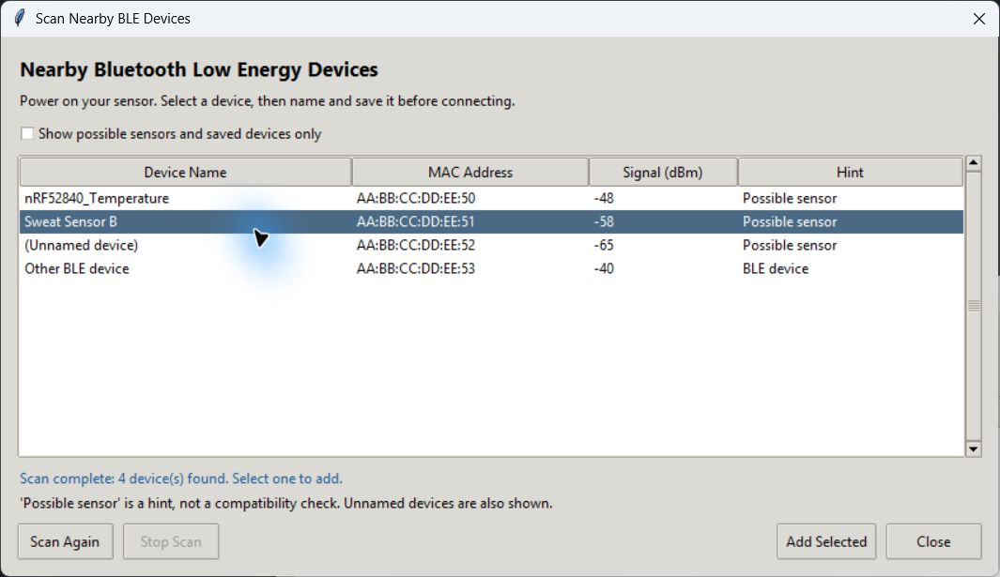

# Wearable Sweat Sensor

Windows desktop software for discovering BLE sensors, collecting voltage from multiple devices, marking experimental events, and saving CSV/TXT data.

**Version 1.1.0 - laboratory preview.** Automated checks use simulated devices. Real sensor connections, voltage scaling, and clean Windows installations still need hardware validation.

## Download and run

Open this repository's **Releases** page and download `WearableSweatSensor-1.1.0-win64-with-manual.zip`. GitHub's automatically generated "Source code" archives do not contain the executable.

1. Extract the entire ZIP. Keep `WearableSweatSensor.exe` beside `_internal/`.
2. Double-click `WearableSweatSensor.exe`. Python is bundled; no installation or terminal command is required.
3. Read the included `Quickstart-EN.pdf`, also available [here](docs/Quickstart-EN.pdf).

The portable build targets **64-bit Windows** with a working Bluetooth adapter. The executable is not code-signed. This public distribution starts with an empty saved-device list. Existing user configuration is retained when upgrading.

## Connect and measure

1. Charge and power on your sensor; enable Bluetooth on the computer.
2. Click **Scan Devices**. Select the verified device, then **Add Selected**.
3. Name the sensor and click **Save**. In the main list, select it and click **Connect**.
4. Repeat for additional sensors. Each has its own live voltage plot, sample counter, and output files.
5. Click **Stop**, wait for **Disconnected** and **Saved**, then **Close**.

**Add New** accepts a known MAC address. **Open Demo** creates clearly labeled simulated streams and files without real hardware. **Open Data Folder** opens recorded data.

"Possible sensor" is only a broadcast name/service hint, not identity or compatibility verification. Power one device off and on and rescan to identify its MAC. A nearby BLE device must also implement the expected protocol to work with this application. The simultaneous connection limit depends on the adapter, OS, and sensors.



## Standard solutions

The [English guide](docs/Quickstart-EN.pdf) includes the procedure from the original archived Word manual:

- **Low point:** apply **150 ppm** standard solution to the sensing membrane; wait for a stable curve.
- **High point:** apply **2000 ppm** standard solution to the sensing membrane; wait for a stable curve.
- After calibration, begin sweat measurement according to your experimental procedure.

Use your laboratory SOP for volume, handling between solutions, and stability criteria. Record the stable voltage at each point. The application records **mV** and does not perform automatic calibration or concentration conversion.

## Data and event flags

Data is saved automatically to:

```text
%LOCALAPPDATA%\WearableSweatSensor\
    saved_devices.csv
    Data\wearable device\
    diagnostics\application.log
```

Each connection creates matching CSV and TXT files with this format:

```csv
time_s,voltage_mv,event_flag
0.00,125.0,
2.00,126.2,
2.00,126.2,blue
```

Times are relative to the first sample. Each BLE notification creates a sample; a fixed sampling interval is not guaranteed. Press **1 / 2 / 3 / 4** in the live window, or use the colored buttons, for blue / yellow / red / green flags. Assign color meanings in your experiment notes. Flag rows repeat the latest time and voltage; exclude them from sample statistics. Flags update **Last flag** and the files, without drawing event lines on the plot.

The display retains the latest 3,000 samples; output files contain the full acquisition. A connection that receives no samples can leave a header-only file. Reconnecting creates new files. Set `SWEAT_SENSOR_HOME` before launch to use an alternate data directory.

## Development and validation

Use **Python 3.12 x64 on Windows**. From the repository root in PowerShell:

```powershell
py -3.12 -m venv .venv
.\.venv\Scripts\python.exe -m pip install -r requirements-lock.txt
.\.venv\Scripts\python.exe -m unittest discover -s tests -p "test_*.py"
.\.venv\Scripts\python.exe src\app.py
```

For the opt-in GUI self-test, use an isolated data directory:

```powershell
$env:SWEAT_SENSOR_HOME = "$env:TEMP\WearableSweatSensor-selftest"
.\.venv\Scripts\python.exe src\app.py --self-test --report verification\source-gui.json
Remove-Item Env:SWEAT_SENSOR_HOME
```

The packaged executable also supports `--self-test --report <report.json>`. Tests simulate BLE scanning and acquisition; they do not connect to a radio or require a sensor. The full build script runs the unit tests, source GUI checks, and frozen executable checks automatically:

```powershell
.\build.ps1
# Or: .\build.ps1 -Python C:\path\to\python.exe
```

Generated ZIP, SHA-256 checksum, and a concise validation summary appear in `dist/`. Dependency license notices and the English manual are included. No TeX installation is needed to build the application: the PDF is already supplied. To edit the manual, compile `docs/manual/quickstart-en.tex` with XeLaTeX.

## Repository layout

```text
.github/             Windows test/build workflow and issue template
src/                 Tkinter GUI, BLE acquisition, discovery, self-test
tests/               Simulated unit tests
resources/           Empty public device configuration template
docs/                English PDF, LaTeX source, screenshots, release notes
tools/               Release packaging and dependency notices
build.ps1            Test and build entry point
requirements-lock.txt
```

Application behavior is preserved from the earlier v1.1 release. Public packaging removes laboratory MAC defaults, adapts the self-test to configurable defaults, and supplies portable build tooling and documentation. [Changelog](CHANGELOG.md) | [Release notes](docs/RELEASE_NOTES.md) | [License status](LICENSE_STATUS.md)

## License status

No project open-source license has been selected. Making the repository public does not itself grant an open-source license. Third-party dependencies retain their own licenses; these are included in portable releases. The project owner can add the intended license before publishing.
